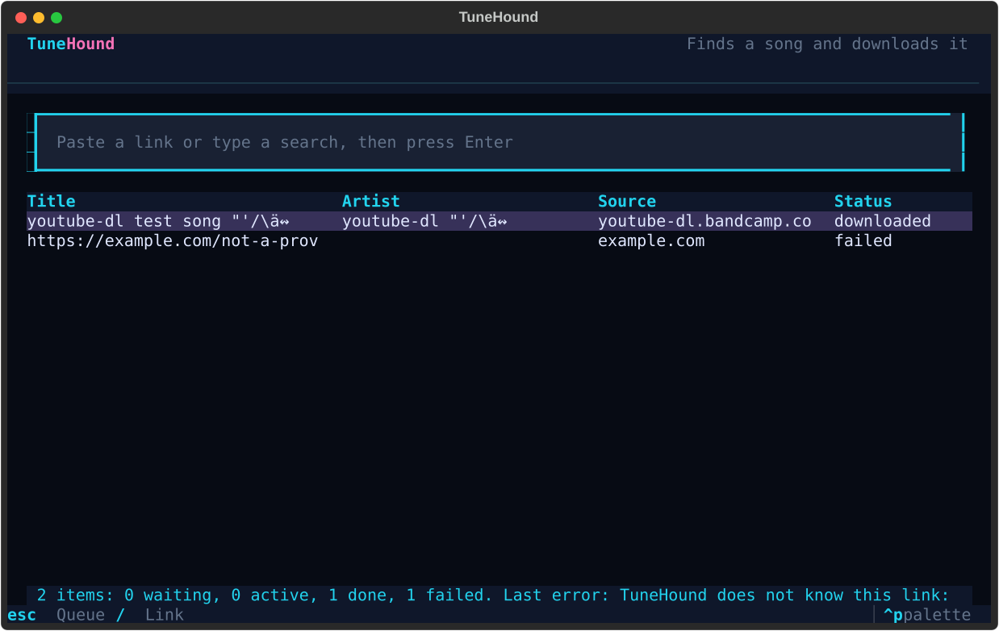

### Finds a song and downloads it

_Paste a link. TuneHound finds the song, downloads it, and tags it._

  <a href="#overview"><b>Overview</b></a> |
  <a href="#use"><b>Use</b></a> |
  <a href="#what-works-now"><b>What works</b></a> |
  <a href="docs/roadmap.md"><b>Roadmap</b></a> |
  <a href="CHANGELOG.md"><b>Changelog</b></a>

---

> [!NOTE]
> **Version 0.2.0 is out.**
> It downloads a song, an album, or a playlist from a Spotify link and tags
> each song.
> [Install](#install) says how to get it, and
> [the roadmap](docs/roadmap.md) says what comes next.

## Overview

TuneHound downloads music from many providers.
It reads the metadata of a song from the provider.
It finds the same song on YouTube and downloads it with yt-dlp.
Then it converts the audio to mp3 with ffmpeg and writes the tags and the
cover.

TuneHound does not decrypt DRM streams.

## Requirements

- Python 3.11 or later
- [uv](https://docs.astral.sh/uv/)
- [ffmpeg](https://ffmpeg.org/) on your `PATH`

## Install

    uv tool install git+https://github.com/Stiven-Gjekaj/TuneHound@v0.2.0

Then run `tunehound` with no `uv run` in front.

## Install for development

    uv sync

## Use

Download one song from a Spotify link into the current folder:

    uv run tunehound download https://open.spotify.com/track/4uLU6hMCjMI75M1A2tKUQC

Download every song of an album or a playlist:

    uv run tunehound download https://open.spotify.com/album/6eUW0wxWtzkFdaEFsTJto6

TuneHound prints one line for each song and a summary at the end. A song
that fails does not stop the other songs. When the file of a song is already
in the folder, TuneHound skips the song, so you can run the same command
again to get the songs that failed.

Put the files in a different folder:

    uv run tunehound download LINK -o ~/Music

YouTube sometimes asks for a sign-in to confirm that you are not a bot.
Then let yt-dlp use the YouTube sign-in of your browser:

    uv run tunehound download LINK --cookies-from-browser firefox

Show the help:

    uv run tunehound --help

Open the terminal user interface:

    uv run tunehound tui

Paste a link and press Enter. The screen puts it in the queue. In this
version the screen does not download yet; use `tunehound download`.
Press `esc` to go to the queue, `/` to go back to the link, and `q` in the
queue to close the app.

## What works now

- Providers: Spotify track, album, and playlist links. Other providers come
  later.
- Lists: the Spotify embed page gave 100 songs at most for a playlist in a
  test. TuneHound warns when a list has 100 songs, because songs can be
  missing.
- Tags: the title, the artists, the release date, the cover, and the link of
  the source. A song from an album link also gets the album and the track
  number. The Spotify embed page does not give the ISRC.
- Format: mp3.
- Match: TuneHound searches YouTube and scores each result by the title, the
  artist, the length, and the channel. It refuses a live version, a remix, or
  a cover when the track is not one. YouTube Music search gives no songs in
  some countries, for example Albania, so TuneHound searches YouTube.

## Test

    uv run pytest
    uv run ruff check .
